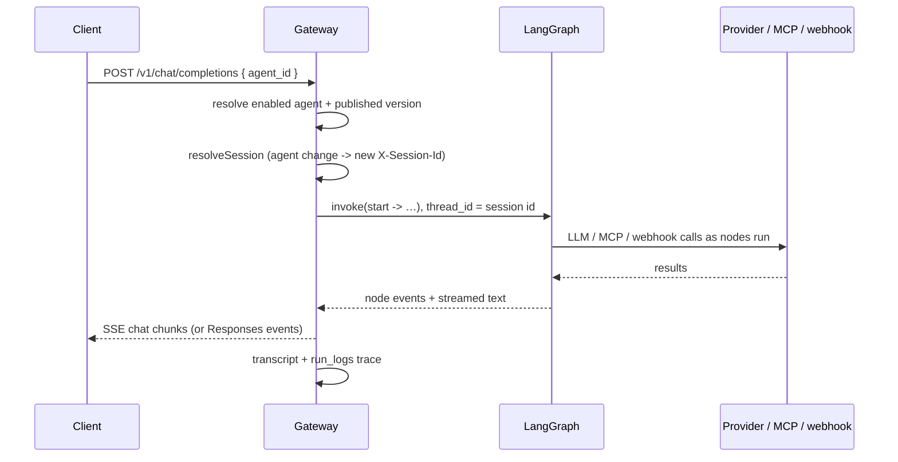

# Agents (chatflows)

An **agent** is a published chatflow: a small visual program that receives the user's message,
runs a series of nodes and streams one or more replies. Clients either send the gateway-issued
agent id as `agent_id` or use the `agent:<id>` model name. Requests without an agent keep using
plain model routes.

This page is the mental model and operating guide. The design is in
[`docs/spec.md`](spec.md) §13; the CRM editor is in §14.

## Mental model

```
Client (Unity)                      Gateway                                    Model / MCP / webhook
  POST /v1/chat/completions           resolve agent -> published version
  { agent_id: "agt_…" }  -----------> compile (cached per version)
                                      load session memory
                                      run LangGraph StateGraph  ---------------> LLM route steps (failover)
                                        Start -> Router -> Webhook -> LLM ...        MCP tools
                                      stream Reply / terminal LLM text  <-------- webhook JSON
  <---------------- SSE chunks         write transcript + run_logs trace
```

- A flow has a **draft** (autosaved by the editor) and immutable numbered **versions**. Only a
  published version runs for clients; publishing validates the draft first.
- The draft and every version are React Flow JSON: `nodes[]` (each with a Zod-validated `data`
  payload) and `edges[]` (source/target node ids plus a `sourceHandle`).
- At request time the published graph is compiled to a LangGraph `StateGraph`, cached by
  `(flow id, version)`. The graph state is `{ messages, sessionId, vars, memory, output }` plus
  run bookkeeping (`cursor`, `trace`, streamed `text`, usage).
- The checkpointer (`@langchain/langgraph-checkpoint-postgres`) stores each run under
  `thread_id = session id`. Session memory is also stored in `session_memory`, so it survives a
  process restart and is visible in the transcript viewer. Paused client-tool runs (G7b) will
  resume from the same thread.
- **Variables** (`vars`) are per-turn and start empty. **Memory** is per session and persists
  across turns. Templates can read both.
- Session rules are unchanged: no `X-Session-Id` starts a session; a request with a different
  `agent_id` than the session's ends the old session (`end_reason = agent_changed`) and returns a
  new `X-Session-Id`. Unknown/disabled agents are `400 invalid_agent`, never 404.
- Every production run writes a `run_logs` row with a per-node trace (inputs, outputs, timings,
  errors) linked to the turn and session.

## Nodes

Every node has a **title** and an optional **comment** (the comment travels with the graph; the
icon/popover UI is G7b). Fallible nodes (`LLM`, `Router`, `Webhook`, `MCP Tool`) also have an
`error` output handle. Connect `error` to a recovery path; if it is left unconnected a failure
ends the run as failed.

| Node | What it does |
|---|---|
| Start | Entry point. Exposes the latest user message, history, session id and request info to templates. Exactly one per agent. |
| LLM | Calls a model route (or `inherit`) with a system prompt template and a history choice (full / last N / none). Optionally offers allowed MCP tools and loops (max four rounds). Stores the answer in a variable; streams when it is terminal. |
| Router | Branches on rules (`equals`, `contains`, `regex` on a template) or on an intent label picked by an LLM. One output handle per rule/label plus `default` and `error`. |
| Set Variable | Assigns variables from templates. |
| Webhook | Calls an HTTP endpoint with templated URL/body and encrypted headers, a timeout (default 10 s), 0–3 retries, a response size cap and JSON-path mappings into variables. |
| Memory | `get`, `set`, `append` or `delete` a session memory key. |
| MCP Tool | Calls one allowed tool on a registered MCP server with fixed or templated arguments. |
| Reply | Streams templated text mid-flow. Several Replies stream in order. |
| End | Ends the turn. |

### Examples

Start → Reply (the smallest useful agent):

```json
{
  "nodes": [
    { "id": "start", "type": "start", "position": { "x": 0, "y": 0 }, "data": { "title": "Start" } },
    { "id": "reply", "type": "reply", "position": { "x": 260, "y": 0 }, "data": {
      "title": "Greeting", "template": "Hi! How can I help?" } },
    { "id": "end", "type": "end", "position": { "x": 520, "y": 0 }, "data": { "title": "End" } }
  ],
  "edges": [
    { "id": "e1", "source": "start", "target": "reply", "sourceHandle": "out" },
    { "id": "e2", "source": "reply", "target": "end", "sourceHandle": "out" }
  ]
}
```

LLM node data:

```json
{
  "title": "Answer",
  "model": "inherit",
  "systemPrompt": "You are Aiko, a friendly lobby greeter.",
  "history": "full",
  "historyLimit": 10,
  "mcpToolIds": [],
  "outputVariable": "llm_output",
  "stream": true
}
```

Router with rules (first match wins):

```json
{
  "title": "Which request?",
  "mode": "rules",
  "model": "inherit",
  "rules": [
    { "id": "weather", "label": "Weather", "operator": "contains",
      "subject": "{{input.text}}", "value": "weather" }
  ],
  "intentLabels": [],
  "intentInstruction": "",
  "defaultLabel": "default"
}
```

Intent mode calls the chosen model route and asks for one of `intentLabels`; handles are
`intent:<label>` plus `default`. If the model does not name a label the `default` handle is used.

Webhook node data (headers are write-only and encrypted at rest):

```json
{
  "title": "Check lobby status",
  "method": "GET",
  "url": "https://lobby.internal/status",
  "headers": [{ "name": "X-Api-Key" }],
  "bodyTemplate": "",
  "timeoutMs": 10000,
  "retries": 1,
  "maxResponseBytes": 65536,
  "mappings": [{ "variable": "hook_value", "path": "data.value" }],
  "outputVariable": "hook_payload"
}
```

Memory node: `operation: "append"`, `key: "history"`, `value: "{{input.text}}"` keeps a
newline-separated log across turns. MCP Tool node: pick the server and one allowed tool; each
argument value is a template, and JSON-looking values are passed as JSON.

## Templates

`{{input.text}}`, `{{vars.x}}`, `{{memory.x}}`, `{{nodes.<id>.output}}` interpolate dotted paths.
Interpolation is a lookup, never evaluation: missing paths render as an empty string, functions
and prototypes are unreachable, and there is no way to run code. The editor suggests paths after
`{{` and underlines references it cannot resolve.

- `input.text` — the latest user message
- `input.messages`, `input.sessionId`
- `vars.<name>` — variables set by Set Variable, Memory, Webhook, MCP Tool or LLM nodes
- `memory.<key>` — session memory at the start of the run
- `nodes.<node id>.output` — the output of a node that already ran this turn

## Publishing and versions

1. The editor autosaves the draft (last save wins; if another save happened after the copy you
   opened, the API reports a conflict warning but still saves).
2. **Publish** validates the draft: schema-valid nodes, exactly one Start, every path reaches a
   Reply/End, no orphan nodes, required fields set, and no cycles except edges marked as loops.
   Problems are returned per node and shown on the cards and in the publish dialog.
3. Publishing stores the next immutable version with an optional note. Clients pick it up on
   their next request; in-flight sessions keep their agent version.
4. **Version history** can view a version and restore it into the draft. Restoring does not
   publish: publish again to make it live.
5. The **slug** is fixed once the chatflow has a published version. Renaming is always allowed.
6. Duplicating copies the draft, settings and webhook header secrets; the copy starts disabled
   and unpublished.

## Runtime and checkpointing

- The request's `messages` are the conversation history (Unity sends the full history). LLM
  nodes choose how much of it to forward.
- `Reply` text and terminal LLM output stream as OpenAI chat chunks (`/v1/chat/completions`) and,
  through the existing translators, as Responses events (`/v1/responses`). Non-terminal LLM
  output is stored in its variable only.
- The compiler prefixes LangGraph node names internally so a node titled `memory` cannot collide
  with the `memory` state channel.
- Memory is persisted in `session_memory`; run traces in `run_logs` with `session_id` and
  `turn_id`, so the transcript viewer can show both. A run that fails before any node still gets
  a run log with the error.
- Session deletion and the retention purge clear `run_logs`, `session_memory` and the checkpoint
  rows for those sessions (registered purge hook).
- Webhook header values live in `flow_webhook_secrets` (AES-256-GCM, one row per flow/node/name)
  rather than inside the graph, so key rotation covers them; the draft and versions store only
  header names. Runtime reads the current header values for the flow.
- Test runs from the editor run the saved draft with an isolated in-memory memory store and do
  not write run logs.

### Request to stream



## CRM

- **Chatflows** lists agents with create, duplicate, JSON import, enable/disable and delete.
- The **editor** has a left palette (Flow / AI / Actions / Data / Notes), a dotted React Flow
  canvas (zoom, minimap, snapping, auto-layout, fit), a right inspector generated from the node
  schemas, undo/redo, copy/paste, multi-select, a problems list and the autosave indicator.
- **Sticky notes** are canvas-only Markdown nodes (raw HTML is escaped, never rendered). They are
  resizable, edited by double-clicking, use theme-token colours (yellow, blue, green, pink, grey),
  layer with Bring forward / Send backward, and are versioned and exported. The validator and the
  compiler ignore them.
- **Node comments**: every node keeps a comment plus `commentUpdatedAt`. Commented nodes show a
  speech-bubble badge with a popover (text and last-edited time); edit the text in the inspector.
- **Visual groups**: select nodes and press `Ctrl+G` (or the toolbar Group button) to wrap them in
  a titled frame. A group moves as one, can be collapsed to a single box, and can be ungrouped
  with the toolbar or `Ctrl+Shift+G`. Groups are purely cosmetic: the compiler and validator
  flatten their children and ignore the frame. The "Convert group to subflow" action is reserved
  until subflows land.
- The toolbar eye toggles all sticky notes and comment badges. **Version history** can compare a
  version with the draft: added, removed and changed nodes (and edges) are highlighted on the
  canvas with a legend and a summary list; it is view only.
- **JSON export** writes the draft or a version without secrets (webhook headers keep their names
  only). **JSON import** creates a new flow, runs the same validation as publish, and lists the
  webhook headers that need re-linking.
- Duplicating a chatflow copies the draft (including notes and groups), its settings and its
  webhook header secrets; the copy starts disabled and unpublished.
- The **test drawer** runs the saved draft and shows a live trace; clicking a step highlights
  its node and running nodes light up while the run is in progress.
- **Keyboard shortcuts** (ignored while typing in an input): `Ctrl/Cmd+Z` undo, `Ctrl/Cmd+Shift+Z`
  or `Ctrl/Cmd+Y` redo, `Ctrl/Cmd+C`/`V` copy and paste, `Ctrl/Cmd+G` group,
  `Ctrl/Cmd+Shift+G` ungroup, `N` add a sticky note, `Delete`/`Backspace` delete the selection.
- **Settings** holds the agent name, slug, description, enabled flag and default model route.
- The **transcript viewer** shows the session's run traces and memory next to the conversation.

## Troubleshooting

| Symptom | Cause and fix |
|---|---|
| `400 invalid_agent` | The id is unknown, the chatflow is disabled, or it has no published version. Publish it and check Enabled. |
| A new `X-Session-Id` arrives mid-conversation | The client changed `agent_id`; the gateway ended the old session with `agent_changed`. |
| Publish is blocked | Open the publish dialog: validation lists every problem with the offending node title. Every Router handle except `error` must be connected. |
| `llm` node error `route_not_found` | The route was deleted/disabled, or an `inherit` node has no request route and no agent default route. |
| Webhook error on a correct URL | Check the timeout, the response size cap, the retry count and any 4xx. Non-2xx answers take the `error` handle. |
| Template shows an empty value | The path does not exist yet, or `nodes.<id>.output` refers to a node that has not run on this path. Unknown references are underlined in the editor. |
| Memory is not visible next turn | Memory is session-scoped: reuse the `X-Session-Id`. Test-drawer runs use an isolated store. |
| The canvas looks tiny | Use the Fit button or the minimap, or auto-layout. The canvas keeps a 0.6× minimum zoom so cards stay readable with the test drawer open. |
