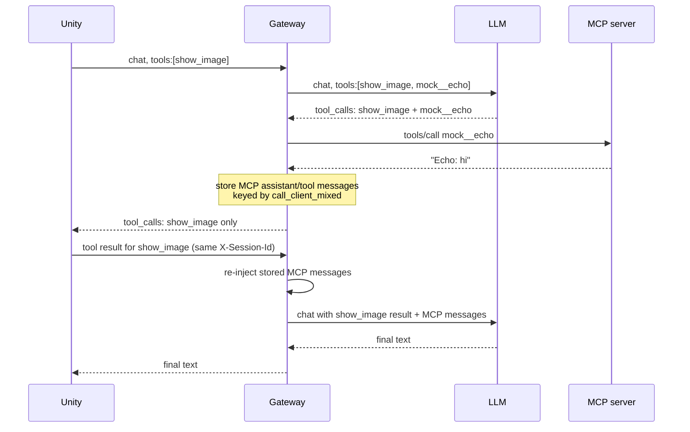

# MCP servers and the plain-chat tool loop

## Mental model

An **MCP server** is an external service that publishes tools over the Model Context Protocol.
The gateway registers servers, fetches their tool catalogue, and lets admins allow individual
tools. A model route selects a subset of the allowed tools. At request time the gateway merges
those tools into the client's `tools` array, runs the model, executes any MCP calls itself, and
loops until the model answers without them.

```
Client (Unity)                         Gateway                          MCP server
   |  tools: [show_image]                 |                                  |
   |------------------------------------->| route: avatar-default            |
   |                                      | + allowed MCP tools:             |
   |                                      |   composio__GMAIL_SEND_EMAIL     |
   |                                      |--------------------------------->|
   |                                      |  POST /chat/completions          |
   |                                      |  tools: show_image, composio__…  |
   |                                      |<---------------------------------|
   |                                      |  tool_calls: composio__…         |
   |                                      |  call tools/call --------------> |
   |                                      |<------------------------------   |
   |                                      |  POST /chat/completions (again)  |
   |                                      |<---------------------------------|
   |<-------------------------------------|  final assistant text            |
```

- **Registry**: name, slug (unique, used as the tool prefix), URL, transport
  (`streamable_http` with SSE as the fallback, chosen per server), encrypted headers, enabled.
  There is no stdio transport in v1.
- **Tools** come from `tools/list`. `input_schema` is stored as JSON Schema and shown in the CRM.
  Tools are **deny by default**; an admin ticks the allowed ones.
- **Exposed name**: `<server_slug>__<tool_name>`, sanitised to OpenAI's function-name characters
  (`[a-zA-Z0-9_.-]`, at most 64 characters). Tools whose exposed name is invalid are skipped, never
  offered. This prevents collisions between servers that both publish `search`.
- **Route selection**: the Model Routes editor lists allowed tools and the route stores the
  selected ids. Only tools that are selected on the route, allowed globally and on an enabled
  server are offered.
- **Secrets**: headers (for example Composio's `x-api-key` and `x-user-id`) are AES-256-GCM
  encrypted at rest, write-only in the CRM, and covered by `pnpm secrets:rotate`.

## The loop

Plain chats (`/v1/chat/completions` and `/v1/responses` without an agent) run the loop:

1. Merge the route's MCP tools into the client tools and call upstream. On an MCP route the
   gateway always uses Chat Completions internally, translating the final answer for Responses
   clients, so the loop behaves identically for both endpoints.
2. If the reply contains no MCP calls, it is the answer: forward it.
3. If it contains only MCP calls, execute them, append an assistant message with those calls and
   one `tool` message per result, then call upstream again.
4. **At most four upstream rounds.** The fourth is called with `tool_choice: "none"`, so the model
   must answer; the gateway never exposes MCP tool names to the client even if a provider ignores
   the hint.
5. **30 s per MCP call.** A call that times out or throws is not fatal: the error text is fed back
   to the model as the tool result and the loop continues.
6. Only the **final** reply streams to the client. Intermediate rounds are never streamed. (On an
   MCP route, streaming output is emitted once the final reply is known.)

### Mixed replies (client tools + MCP tools)

One model reply can ask for both Unity/client tools and MCP tools. The gateway:

1. executes the MCP calls first;
2. returns **only the client tool calls** to the client (the client executes them);
3. stores the MCP assistant message and its tool results, keyed by the client tool call ids;
4. on the client's next request (which carries the client tool results), re-injects the stored
   MCP messages before the client's assistant/tool messages, then forwards upstream.

This keeps Unity's session contract unchanged: Unity only ever sees tools it declared.



## Transcripts

Every MCP call becomes two transcript items, `tool_call` and `tool_result`, with
`tool_source = 'mcp'`, the exposed tool name, parsed arguments, the result (or `Error: …`), and
`duration_ms`. The transcript viewer shows the MCP badge, the duration and an Error badge for
failed calls. Request rows still store no content.

## CRM

- **MCP Servers**: register and edit servers (headers write-only), test the connection, refresh
  `tools/list`, and browse tools with allow switches and a JSON Schema preview.
- **Model Routes**: pick the allowed MCP tools offered on each route.

## Admin API

All under `/api/admin` (Basic auth), JSON, Zod-validated:

| Endpoint | Purpose |
|---|---|
| `GET/POST /mcp-servers`, `GET/PATCH/DELETE /mcp-servers/{id}` | CRUD. On update an absent `headers` keeps the stored value; `null` clears it. |
| `POST /mcp-servers/{id}/test` | Connect and `tools/list`; returns `ok`, `duration_ms`, tools or `error` (never header values) |
| `POST /mcp-servers/{id}/refresh-tools` | `tools/list` and upsert into the catalogue, preserving allow flags |
| `GET /mcp-servers/{id}/tools` | Catalogue of one server |
| `GET /mcp-tools`, `GET /mcp-tools?allowed=true` | All tools / tools usable on a route |
| `PATCH /mcp-tools/{id}` | `{ "allowed": true }`; blocking a tool removes it from every route |
| Route `mcp_tool_ids` | `POST/PUT /routes` take the selected tool ids; unknown or blocked ids are rejected with `400 mcp_tool_not_allowed` |

## Composio setup

Composio hosts MCP servers per connected app. The gateway only needs its URL and two headers;
account connections are made in Composio's own dashboard.

1. Create a Composio account and connect the apps you want the avatar to use (Gmail, Calendar,
   Slack, …) in the Composio dashboard. Note the **user id** whose connections the gateway should
   act as.
2. Copy the MCP server URL from Composio's MCP settings for that user (it looks like
   `https://mcp.composio.dev/<server>`).
3. In **MCP Servers → New MCP server**, set:
   - Name: `Composio`
   - Slug: `composio` (tools become `composio__<tool>`)
   - URL: the MCP URL from step 2
   - Transport: Streamable HTTP (SSE only if Composio tells you to use it)
   - Headers, one per line:
     ```
     x-api-key: <your Composio API key>
     x-user-id: <the user id from step 1>
     ```
4. **Test** the connection, then **Browse tools** and allow the ones the model may call.
5. In **Model Routes**, edit the avatar route and tick the allowed Composio tools.

Headers are encrypted and never shown again after saving. Use placeholders above; never commit
real keys. The same pattern works for any MCP server: URL plus optional headers, then allow tools.

## Tests and local mocks

`tests/support/mock-mcp.ts` is a real SDK-based MCP server with `echo`, `add`, `slow` and `fail`.
Integration tests point a registered server at it and drive the loop through the gateway; the
`slow` tool exceeds a test-only 250 ms call timeout. E2E and screenshot seeds use the same server
on port 4312.
