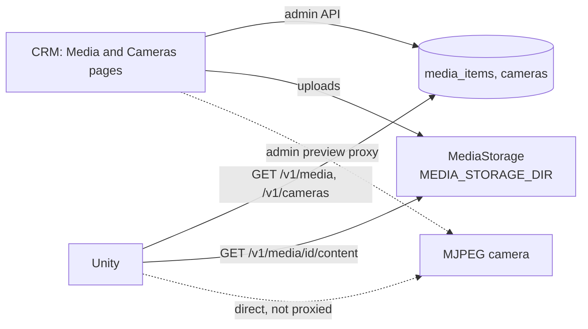

# Media Content

The gateway keeps two catalogues the avatar can draw on: **media** (images and videos) and **cameras**
(live feeds). Unity reads them through the client API and the model chooses what to show by calling
Unity-side tools such as `show_image` / `show_camera`. The gateway only stores and serves the data.

## Mental model: ids

Every item has a stable id: `med_` + 12 hex characters for media, `cam_` + 12 hex for cameras. Unity
lists the catalogue, hands the model the names, descriptions and tags, and the model's tool call
carries the id back (`{"media_id": "med_..."}`, `{"camera_id": "cam_..."}`). Ids never change, so
renaming an item does not break anything. Write good **descriptions**: the model reads them to choose.
Tags drive which items an agent is allowed to use (G7).

## Media

| Field | Notes |
|---|---|
| `kind` | `image` or `video`, derived from the file's real type |
| `source` | `upload` (bytes stored by the gateway) or `external_url` (only linked) |
| `tags` | Lowercase, trimmed, unique; max 20 tags of 32 characters |
| `enabled` | Disabled items are hidden from `GET /v1/media` and 404 on `/content` |

### Limits

| Type | Allowed | Max size |
|---|---|---|
| Images | PNG, JPEG, GIF, WebP | 20 MB |
| Videos | MP4, WebM | 200 MB |

The type is identified from the file's **magic bytes** (the `file-type` package). The browser's
declared type and the file name are ignored, so an HTML file renamed `.png` is rejected with
`415 unsupported_media_type`. Oversized files get `413 media_too_large`. Image width and height are
read with `image-size` and shown in the CRM.

### Storage

Uploads implement the `MediaStorage` interface (`src/server/media/storage.ts`); today the only
implementation is `LocalDiskMediaStorage`, which writes one flat file per item
(`<id>.<ext>`) under `MEDIA_STORAGE_DIR` (default `/data/media`, a Docker volume). An S3 backend
needs a new class and nothing else. Uploads are streamed to disk through a multipart parser
(busboy), never buffered whole, and a rejected upload leaves nothing behind (a `.part` file is
removed). Deleting an item deletes its file.

For local `pnpm dev`, set `MEDIA_STORAGE_DIR=./data/media` in `.env` (`data/` is git-ignored).

The upload route `POST /api/admin/media/upload` is excluded from the Next.js proxy matcher
(`src/proxy.ts`) because the proxy buffers, and past 10 MB truncates, request bodies. It still
requires admin authentication: the Hono admin app checks the credentials itself. Text fields
(`name`, `description`, `tags`, `enabled`) must be sent **before** the `file` part.

### External URLs

"Add external URL" stores only the link. On save the gateway sends `HEAD` (falling back to a
one-byte ranged `GET` when a server refuses `HEAD`), with a 10 s timeout and at most 3 redirects, and
checks the content type against the table above and the size (when the server reports one) against
the limit. Failures are reported in the dialog (`external_url_unreachable`, `unsupported_media_type`,
`media_too_large`). Nothing is rechecked later: a link that goes dead stays in the catalogue.
YouTube pages and S3 buckets are out of scope. The check runs from the gateway host, so only add URLs
you trust.

## Client API

All routes need the usual `Authorization: Bearer <key>`.

- `GET /v1/media` returns `{"object":"list","data":[{id,name,description,kind,tags,content_url,mime_type}]}`
  for enabled items. `content_url` is absolute: `PUBLIC_BASE_URL`, else the forwarded host
  (`X-Forwarded-Host`/`-Proto`), else the request origin, plus `/v1/media/{id}/content`. For external
  items it is the external URL itself.
- `GET /v1/media/{id}/content` streams an upload with `Accept-Ranges: bytes`, a single `Range`
  (`bytes=a-b`, `a-`, `-n`) answered `206` with `Content-Range`, `416` (with `Content-Range: bytes */size`)
  for an unsatisfiable range, `ETag` (and `304`), `If-Range`, and `Cache-Control: private, max-age=3600`.
  Several ranges, other units or malformed values are ignored and the whole file is sent. External
  items answer `302` to their URL. Unknown or disabled ids answer `404` with code `media_not_found`
  (never `session_not_found`).
- `GET /v1/cameras` returns `{"object":"list","data":[...]}` of enabled cameras in sort order:
  `{id,name,description,type, url?, credentials?}`.

## Cameras

`type` is an **open union**: the column is plain text and the Zod discriminated union in
`src/lib/media-schemas.ts` decides what can be written. Clients must ignore types they do not know.

| Type | Config | In `/v1/cameras` |
|---|---|---|
| `lookat_sidecar` | none | no `url`: Unity uses the look-at provider it already has configured |
| `mjpeg_url` | `url` (http/https, no `user:pass@`), optional credentials | `url`, and `credentials: {username, password}` when set |
| `rtsp_via_relay` | *reserved, not implemented* | see below |

Credentials are encrypted with `GATEWAY_ENCRYPTION_KEY` (column `cameras.credentials`, covered by
`pnpm secrets:rotate`) and are **write-only in the CRM**: the form shows the masked username
(`v••••r`) and never the password. They are delivered in plain form to authenticated clients through
`/v1/cameras`, because Unity must send them to the camera.

### Direct connection versus the admin preview proxy

Unity connects to cameras **directly**; the gateway never proxies video to clients. The CRM cannot do
that (the browser would need the credentials and CORS), so `GET /api/admin/cameras/{id}/preview`
proxies the MJPEG stream for admins only, adding the stored credentials server-side, and
`POST /api/admin/cameras/{id}/test` checks that the URL answers `multipart/x-mixed-replace` and sends a
frame boundary within 5 s. Neither exists for `lookat_sidecar`. The proxy aborts the upstream request
when the browser disconnects.

### Future: RTSP

Security cameras usually speak RTSP, which browsers and Unity's MJPEG reader cannot open. The plan is a
relay such as go2rtc or MediaMTX that republishes RTSP as MJPEG/HLS, registered as a new
`rtsp_via_relay` camera type (relay URL plus stream name). Nothing for it is implemented yet; adding it
means a new member of the Zod union and a new CRM form section.

## Troubleshooting

| Symptom | Likely cause |
|---|---|
| Upload fails with 415 | The file's contents are not an allowed type; re-export it |
| Upload fails with 413 | Over 20 MB (image) or 200 MB (video) |
| Upload of a big video stalls behind a reverse proxy | Raise the proxy's body-size limit (Caddy has none by default) |
| External URL rejected: unreachable | Wrong URL, more than 3 redirects, slower than 10 s, or the server blocks the gateway |
| `content_url` points at `localhost` | Set `PUBLIC_BASE_URL` (or forward `X-Forwarded-Host`) |
| Media 404 after restart in Docker | `MEDIA_STORAGE_DIR` is not on the `media-data` volume |
| Camera test: "Expected multipart/x-mixed-replace" | The URL serves a single JPEG or HTML, not an MJPEG stream |
| Camera test: HTTP 401 | Wrong credentials; enter both username and password to replace them |
| Preview is blank | The camera is unreachable from the gateway host (the browser never contacts it) |
