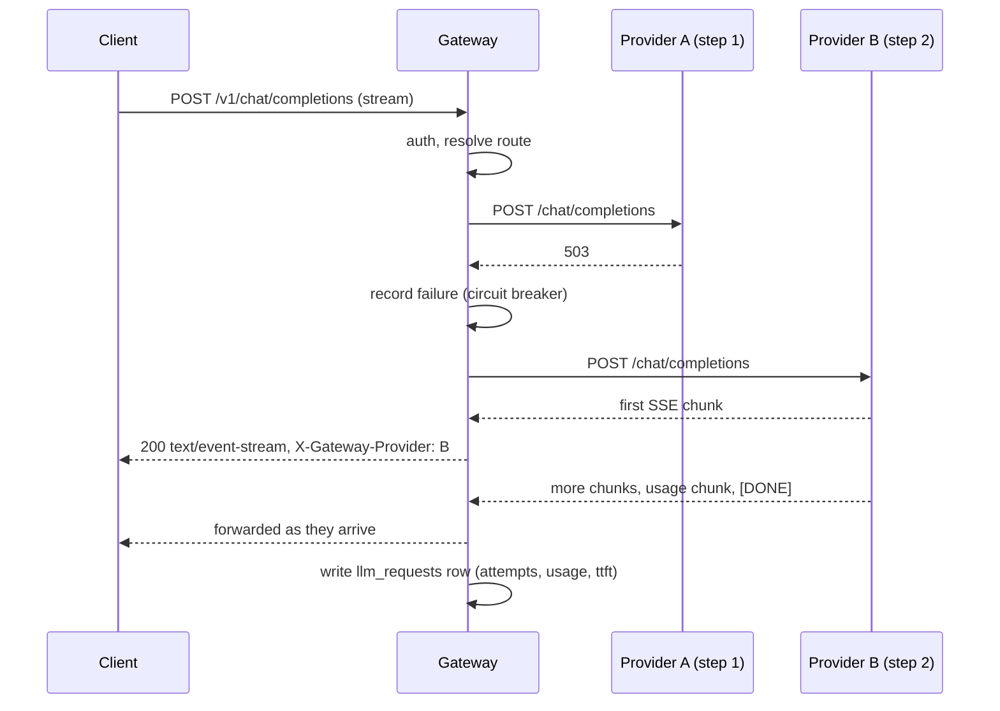

# Providers, model routes and failover

## Mental model

```
Unity / client  ->  model: "avatar-default"   (a route slug)
                         |
                  Model route  --  step 1: Provider OpenAI   / gpt-4o-mini  (timeout 20 s)
                                   step 2: Provider DeepSeek / deepseek-chat (timeout 30 s)
```

- A **provider** is one OpenAI-compatible upstream: name, base URL, optional API key, enabled
  flag, capability flags (`streaming`, `tools`, `responses_api`) and optional extra headers.
  The key and the extra headers are AES-256-GCM encrypted at rest and write-only: the CRM and the
  admin API only ever show a masked key (`sk-…a1b2`) and the header names. A keyless provider
  (Ollama, LM Studio, vLLM) simply has no key.
- A **model route** is the model name clients see. Its ordered **steps** each name a provider,
  the upstream model to ask for, and a timeout. A route can also select **allowed MCP tools**;
  they are merged into the client's `tools` and executed by the gateway. See
  [mcp.md](mcp.md). `GET /v1/models` lists the enabled routes.
- Exactly one route is the **default**. The first route you create becomes the default; change it
  with the star button on the Model Routes page or `POST /api/admin/routes/{id}/default`.
  The default route cannot be disabled or deleted while other routes exist.

## Which route does a request use?

| Request `model` | Result |
|---|---|
| a slug of an enabled route | that route |
| absent, empty, whitespace or `default` | the default route |
| anything else, or a disabled route | `400 model_not_found` |

The Unity client omits `model` when its model dropdown is set to "default", so the default route
must always exist for that case to work. Unknown models return **400, not 404**: on chat routes
404 is reserved for `session_not_found` (Unity treats any 404 on a session request as expiry).

`POST /v1/responses` follows the same route resolution, failover, error mapping and logging. Each
step is called natively (`{base_url}/responses`) when its provider has the `responses_api`
capability, otherwise through `/chat/completions` with translation both ways; see
[responses-api.md](responses-api.md).

`POST /v1/chat/completions` passes every field it does not understand straight to the upstream
(`tools`, `tool_choice`, `reasoning_effort`, `thinking`, ...). `model` is replaced by the step's
upstream model, and the gateway-only field `agent_id` is removed. For streams the gateway adds
`stream_options: {"include_usage": true}` unless the client sent its own `stream_options`.

## Failover rules

For each step in order the gateway skips the step if its provider is disabled or its circuit is
open, otherwise it sends the request and classifies the outcome:

| Upstream outcome | Action |
|---|---|
| Connection error, DNS failure, reset | fail over to the next step |
| Timeout (`timeout_ms`) | fail over |
| HTTP 408, 429, 5xx | fail over |
| 200 with an empty stream or a non-JSON body | fail over |
| Other 4xx | **no failover**: mapped error returned (table below) |
| 2xx | success |

`timeout_ms` covers connect, response headers and (for streams) the first SSE data chunk. For
non-stream requests it covers the whole response. A slow stream that is already flowing is never
cut by it.

**Streams and the first chunk.** The gateway does not send anything to the client until the first
upstream data chunk arrived, so failover is invisible. After the first chunk is forwarded there is
no failover: if the upstream then breaks, the client receives
`data: {"error":{"message","type","code":"upstream_stream_error"}}` followed by `data: [DONE]`.

If every step fails or is skipped the client gets `502 all_providers_failed` with a message that
lists each provider and its outcome (never secrets).



## Error mapping

| Situation | Client sees | `error.code` |
|---|---|---|
| Missing/unknown/revoked API key | 401 | `invalid_api_key` |
| IP not in the key's allowlist | 403 | `ip_not_allowed` |
| Requests/minute or tokens/day exceeded | 429 + `Retry-After` | `rate_limit_exceeded` |
| Invalid JSON, or `messages` missing | 400 | `invalid_json` / `invalid_request` |
| Unknown or disabled route | 400 | `model_not_found` |
| Upstream 400 or 422 | 400 (upstream message) | `upstream_bad_request` |
| Upstream 401 or 403 | 502 | `upstream_auth_failed` |
| Upstream 404 | 502 (never 404) | `upstream_not_found` |
| Other upstream 4xx | 502 | `upstream_error` |
| All steps failed or skipped | 502 | `all_providers_failed` |
| Upstream broke after streaming began | in-stream error chunk, then `[DONE]` | `upstream_stream_error` |

All errors use the OpenAI shape `{"error":{"message","type","code"}}`.

## Circuit breaker

In memory, per provider (so it resets on restart and is not shared between processes):

- 3 consecutive failover-class failures **open** the circuit: the provider is skipped for 30 s
  (it appears as `skipped_circuit_open` in the request's attempts).
- After 30 s the circuit is **half-open**: exactly one trial request is allowed. Success closes
  the circuit; failure re-opens it for another 30 s.
- A success at any point resets the failure count. Non-failover 4xx responses neither count as
  failures nor as successes.

The Providers page shows the state (Healthy, Circuit open, Half-open).

## Request log

Every client request writes one `llm_requests` row: API key, route slug, the provider and
upstream model that answered, stream flag, status, HTTP status, error code, start time, duration,
time to first token, the client API and the upstream API (`chat` or `responses`; they differ when a
Responses request was translated), the list of attempts (`provider_id`, `provider_name`, `model`, `outcome`,
`http_status`, `error_code`, `latency_ms`) and token usage. **Message content is never stored in this table or
logged.** Since G3 each row also carries `session_id` and `turn_id`; the transcript text lives in
`transcript_items` (see [sessions-and-transcripts.md](sessions-and-transcripts.md)).

## Admin API

All under `/api/admin` (Basic auth), JSON, Zod-validated:

| Endpoint | Purpose |
|---|---|
| `GET/POST /providers`, `GET/PATCH/DELETE /providers/{id}` | CRUD. On update an absent `api_key` / `extra_headers` keeps the stored value; `null` clears it. Delete is blocked with `409 provider_in_use` (and the route slugs) while a route uses the provider |
| `POST /providers/{id}/test` | `GET {base_url}/models` with a 5 s timeout; returns `ok`, `latency_ms`, `model_count`, `models`, `error` |
| `GET/POST /routes`, `GET/PUT/DELETE /routes/{id}` | CRUD; `PUT` replaces the ordered `steps` array and the `mcp_tool_ids` selection |
| `POST /routes/{id}/default` | Make a route the default |

For API keys see [api-keys.md](api-keys.md); for MCP servers and tools see [mcp.md](mcp.md).

## Trying it locally

```bash
pnpm exec tsx tests/support/run-mock-upstream.ts      # mock provider on :4010
# create a provider (base URL http://127.0.0.1:4010), a route whose step uses upstream model
# "ok" and an API key in the CRM, then:
curl -N http://localhost:3000/v1/chat/completions \
  -H "Authorization: Bearer agx_..." -H "Content-Type: application/json" \
  -d '{"model":"avatar-default","stream":true,"messages":[{"role":"user","content":"hi"}]}'
```

The mock selects behaviour by upstream model name: `ok`, `fail-500`, `fail-429`, `fail-401`,
`fail-404`, `bad-request-400`, `slow`, `midstream-fail`, `empty-stream` (plus `reasoning`, `think-tags`,
`tool-call`, `echo`) for `/chat/completions` and `/responses` alike. Put a `fail-500` step
before an `ok` step to watch a failover.
