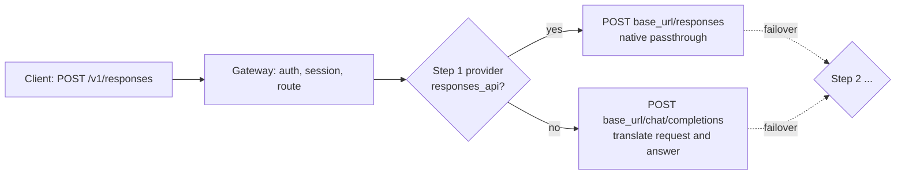
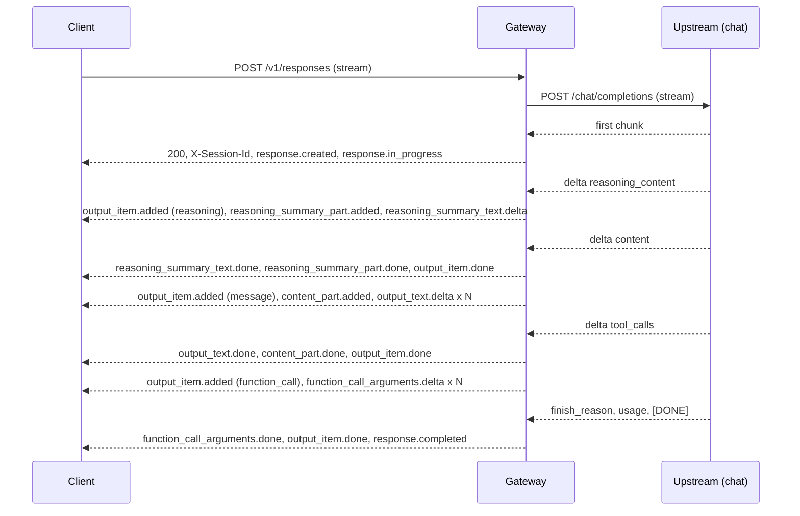

# Responses API (`POST /v1/responses`)

AGENTX can talk to the gateway with OpenAI's Responses wire format instead of Chat Completions.
The gateway accepts it for any route and provider, even when the upstream only speaks
`/chat/completions`. Everything around the call is shared with chat completions: client auth, rate
limits, the `X-Session-Id` contract, route resolution, failover, the circuit breaker, request
logging and transcripts.

## Mental model

The gateway's internal canonical format is Chat Completions. Each route **step** decides on its
own how to reach its provider:

| Provider capability `responses_api` | Mode | Upstream call |
|---|---|---|
| on | **native** | the request is forwarded as-is to `{base_url}/responses` with `model` rewritten |
| off | **translated** | the request is converted to `{base_url}/chat/completions`, and the answer is converted back |

Set the flag per provider in the CRM (Providers > edit > Responses API). A route can mix both
kinds of step, and failover works across them: the first step may be native OpenAI and the second a
translated DeepSeek. When no agent is involved the mode depends only on
the step's provider. When the request runs an agent (`agent_id` or `agent:<id>`), the Responses
wire format is only the client-facing shape: the agent's LLM nodes always call providers through
`{base_url}/chat/completions`, and the gateway translates the agent's output to Responses events
(see [agents.md](agents.md)).



Every request row records both APIs (`client_api` and `upstream_api`: `chat` or `responses`), and
the transcript viewer shows a badge such as `responses → chat` for a translated turn.

## Request handling

- `previous_response_id` is rejected with `400 unsupported_parameter`: the gateway is stateless for
  Responses, so the client sends the full `input` every time (the AGENTX client already does this
  with `store: false`).
- `item_reference` input items are rejected the same way.
- `model` is a route slug. When it is absent, empty or `default`, the default route is used.
- A request that is invalid, unauthorized, rate limited or for an unknown route fails before a
  session exists (no `X-Session-Id`). Otherwise the session contract is identical to chat: no header
  starts a session, an unknown or ended id is `404 session_not_found` (the only 404).
- **Native**: the body is forwarded with `model` replaced and the gateway-only field `agent_id`
  removed. Unknown fields (`include`, `store`, `reasoning`, ...) pass through untouched.
- **Translated**: only the fields in the table below survive; everything else is dropped.

### Request mapping (Responses to Chat)

| Responses field | Chat Completions result |
|---|---|
| `instructions` | first message, `role: system` |
| `input` as a string | one `user` message |
| `input` item `message`, role `user` / `assistant` / `system` | the same role |
| `input` item `message`, role `developer` | `role: system` (not every upstream knows `developer`) |
| content parts `input_text`, `output_text` | text (several parts are joined with a newline) |
| content part `input_image` (`image_url`, `detail`) | `{type:"image_url", image_url:{url, detail}}` on user messages |
| `input_file`, `input_audio` parts | `400 unsupported_input` |
| item `function_call` (`call_id`, `name`, `arguments`) | `tool_calls` entry on an assistant message; it joins the assistant message right before it, so text plus calls stay one message |
| item `function_call_output` (`call_id`, `output`) | `role: tool`, `tool_call_id`; an object output is JSON-encoded |
| item `reasoning`, other output items | dropped |
| `tools` `{type:"function", name, description, parameters, strict}` | `{type:"function", function:{name, description, parameters, strict}}` |
| `tools` of any other type (`web_search`, `file_search`, ...) | `400 unsupported_tool` |
| `tool_choice` `auto` / `none` / `required` | the same value |
| `tool_choice` `{type:"function", name}` | `{type:"function", function:{name}}` |
| `temperature`, `top_p`, `parallel_tool_calls`, `user` | pass through |
| `max_output_tokens` | `max_tokens` |
| `reasoning.effort` | `reasoning_effort` (`reasoning.summary` is dropped) |
| `store`, `include`, `truncation`, `metadata`, unknown fields | dropped (`store` is ignored) |

A route is checked up front: if **any** of its enabled steps is translated, a request with
non-function tools is rejected with `400 unsupported_tool` before the session is created, even if
the first step is native. A route made only of native steps accepts any tool type the upstream
accepts.

### Response mapping (Chat to Responses)

| Chat Completions | Responses |
|---|---|
| answer text (with `<think>` tags removed) | `message` item: `{type:"message", id:"msg_…", role:"assistant", status:"completed", content:[{type:"output_text", text, annotations:[]}]}` |
| `reasoning_content`, `reasoning`, `<think>…</think>` | `reasoning` item with `summary: [{type:"summary_text", text}]`, before the message |
| `tool_calls[]` | one `function_call` item each: `{type:"function_call", id:"fc_…", call_id, name, arguments, status:"completed"}` |
| `usage.prompt_tokens` / `completion_tokens` / `total_tokens` | `usage.input_tokens` / `output_tokens` / `total_tokens` |
| `finish_reason: length` | `status:"incomplete"`, `incomplete_details:{reason:"max_output_tokens"}` |
| `finish_reason: content_filter` | `status:"incomplete"`, `incomplete_details:{reason:"content_filter"}` |
| route | `model` is the route slug, `id` is `resp_…`, `object` is `response` |

Output order is always reasoning, message, function calls.

## Streaming

Translated and native streams use `event: <type>` lines with a JSON `data:` line that repeats
`type` and carries a monotonic `sequence_number`. Responses streams have **no `[DONE]` sentinel**
(AGENTX parses every `data:` line as JSON, so a `[DONE]` would break it); the gateway drops the
sentinel if a native upstream sends one.



Only one output item is open at a time: when the model switches between reasoning, text and a tool
call the previous item is closed first. A function call is announced (`output_item.added`) once its
name is known. The final `response.completed` carries the full `response` including every item,
which AGENTX treats as authoritative.

Terminal events:

| Situation | Last event |
|---|---|
| normal end | `response.completed` |
| `finish_reason: length` / `content_filter` | `response.incomplete` (AGENTX reports it as a failed stream, the same as for OpenAI) |
| upstream breaks after output started, or sends an in-stream error | `response.failed` with `response.error {code, message}` |

**Native passthrough** forwards each upstream event unchanged while observing it for the transcript
(output text, reasoning summaries, function calls, and `usage` from `response.completed`). If the
upstream connection ends without a terminal event the gateway appends a synthetic
`response.failed` (`upstream_stream_error`).

### Failover and the first output

Nothing is sent to the client until the first upstream event that carries output. For a native
stream, `response.created` and `response.in_progress` do not count: if the connection drops, the
upstream sends `error` / `response.failed`, or the stream ends before any output event, the gateway
fails over to the next step. After the first output event there is no failover. The step timeout
covers that waiting period.

## Sessions and transcripts

The gateway normalizes the Responses `input` into chat messages (the table above) and then applies
the same logic as for chat: the new items of a request are the messages after the last assistant
message, system text comes from `instructions` and system/developer messages, and a request that
contains a new user message opens a new turn. A tool round trip does not: the client's next request
carries the model's own output items (reasoning, message, `function_call`) followed by the
`function_call_output`; the output items merge into one assistant message, the result becomes a
`tool_result` linked to the call by `call_id`, and the turn count stays the same. The output
(reasoning, text, function calls) is captured identically for native and translated answers, so a
Responses session looks exactly like a chat session in the viewer.

## Trying it

```bash
pnpm exec tsx tests/support/run-mock-upstream.ts
# Providers: "Native" (responses_api on) and "Chatty" (off), both base URL http://127.0.0.1:4010
curl -N http://localhost:3000/v1/responses \
  -H "Authorization: Bearer agx_..." -H "Content-Type: application/json" \
  -d '{"model":"avatar-default","stream":true,"input":"hi"}'
```

The mock upstream serves `/responses` too and selects behaviour from the upstream model name (`ok`,
`reasoning`, `tool-call`, `echo`, `fail-500`, `midstream-fail`, `empty-stream`, ...).

## Limitations

- No `previous_response_id` and no `item_reference`: send the full input each time.
- Translated routes only support function tools; hosted tools (web search, file search, code
  interpreter, computer use) need a native-only route.
- No `input_file` or `input_audio` parts; images need a URL (no `file_id`).
- A translated response has no encrypted reasoning, logprobs or annotations; reasoning is a plain
  summary built from what the provider streams (`reasoning_content`, `reasoning` or `<think>` tags).
- `n > 1`, background mode and `GET/DELETE /v1/responses/{id}` are not supported.
- `store` is ignored (nothing is stored for later retrieval).

## Troubleshooting

| Symptom | Cause and fix |
|---|---|
| `400 unsupported_parameter` | The client sent `previous_response_id`; send the full `input` instead |
| `400 unsupported_tool` | A non-function tool on a route that has a translated step; remove it or use a native-only route |
| `502 upstream_not_found` for a native step | The provider does not implement `/responses`; turn off the Responses API flag |
| Client reports a failed stream with `max_output_tokens` | The model hit its token limit; raise `max_output_tokens` |
| Turn badge shows `responses → chat` | Expected: the provider has `responses_api` off |
| No reasoning shown in a translated answer | The provider did not stream `reasoning_content`, `reasoning` or `<think>` tags |
