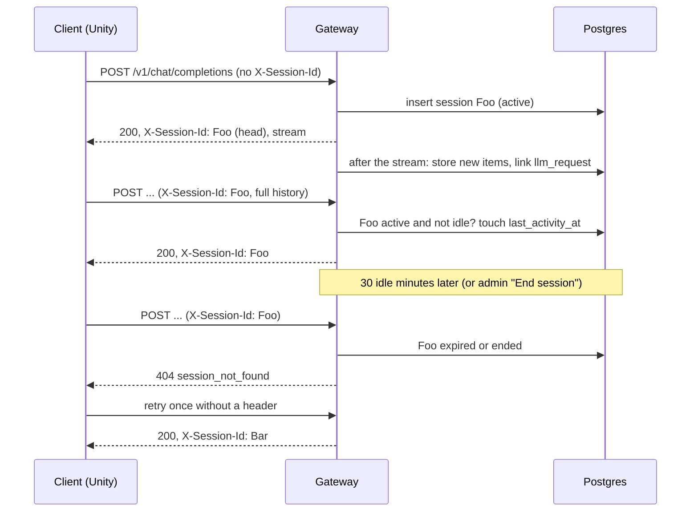
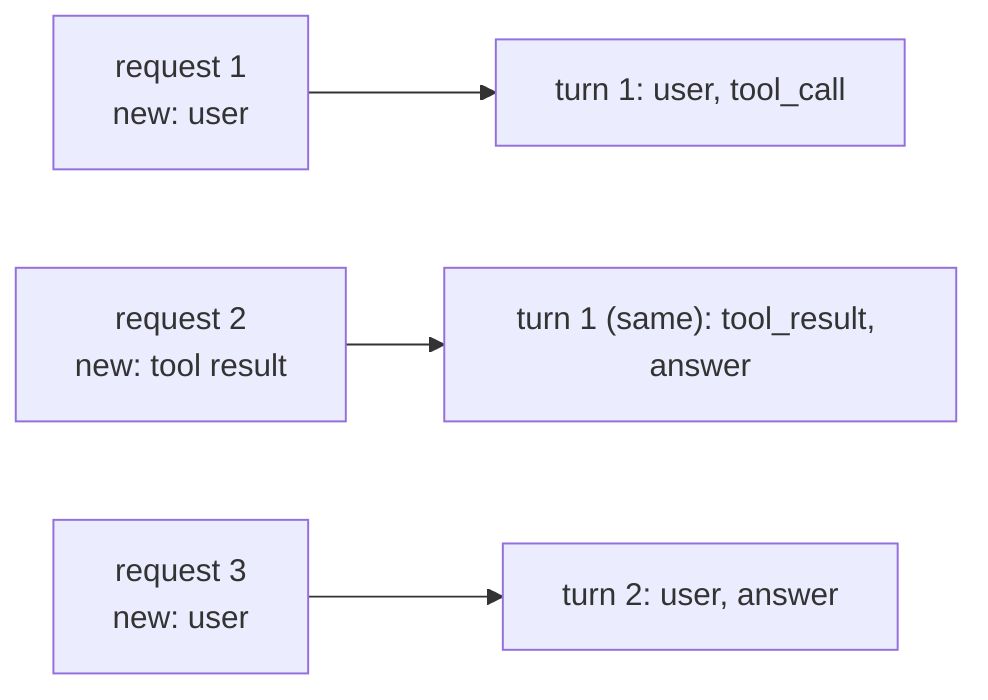

# Sessions and transcripts

The gateway tracks every conversation as a **session**, stores what was said (including the
model's thinking and tool calls) as a **transcript**, and shows it in the CRM under
Conversations > Sessions. This page explains how the contract works, what is stored, and how to
operate it.

## The session contract

The gateway implements the AGENTX session protocol exactly. The client-side specification is
[`llmavatar/llm sessions/01 Protocol.md`](https://github.com/jonmikeys/AGENTX) in the AGENTX
repository (read it first if you are writing a client); the reference stateful server there is
`Tools/LLM/mock_session_server.py`.

| Request | Gateway answer |
|---|---|
| `POST /v1/chat/completions`, no `X-Session-Id` | Creates a session (a UUID chosen by the gateway). `200` with `X-Session-Id: <new id>` |
| header present, session active and not idle | Continues it. `200` with the same `X-Session-Id` |
| header present, id unknown, expired, ended, or owned by another API key | `404 {"error":{"message","type":"invalid_request_error","code":"session_not_found"}}` |
| header present, session idle longer than the timeout | Expired on the spot, then the same `404` |
| `GET /v1/models` | Never requires or reads the header |

`X-Session-Id` is in the **response head** for JSON and for SSE, before the first `data:` event.
It is also present on error responses of a request that created or continued a session (for
example `502 all_providers_failed`). It is absent on `400` validation errors, which happen before a
session exists. A `404` is always `session_not_found`; unknown routes use `not_found`.

### Agents (hook for G7a)

`agent_id` is stored on the session (it is `null` until agents ship). `resolveSession()` already
compares the requested agent with the session's agent: when they differ it ends the old session
with `end_reason = 'agent_changed'` and returns a **new** id, which Unity treats as "conversation
ended". G7a only has to pass the request's `agent_id` into `resolveSession()`.

## What "new items" means

Unity resends the **full** `messages` history on every request. The gateway forwards it upstream
untouched, but stores only what is new, so each message appears once in the transcript:

- **First request of a session:** every non-system message.
- **Later requests:** the messages after the last `assistant` message in the history.
- **System prompt:** the `system`/`developer` messages are stored once as a `system_prompt` item
  and again only when their hash changes.

Then the assistant's answer is added from the upstream response:

| Item kind | Source |
|---|---|
| `user_message` | new client `user` messages |
| `tool_result` | new client `tool` messages, linked to the call by `tool_call_id` (tool name resolved from the call) |
| `reasoning` | `delta.reasoning_content`, `delta.reasoning`, and `<think>...</think>` tags in the content (tags may be split across chunks; they are stripped from the stored answer) |
| `assistant_message` | the visible answer text |
| `tool_call` | assembled from streamed `delta.tool_calls` by index; `tool_source` is `client` (Unity tools). G6 adds `mcp` |
| `error` | an upstream/gateway failure of that request (`all_providers_failed`, a mid-stream error, ...) |
| `system_prompt` | see above |

Capture never slows the stream: chunks are forwarded first and only observed afterwards, the
text accumulates in memory, and everything is written in one transaction after the stream ends
(also after a client disconnect or an upstream error, so partial answers are kept). A
`client_closed` outcome stores the partial text but no error item. Transcript text is never
logged.

## Turn grouping

A **turn** starts when the new items contain a `user` message. A request whose new items are only
`tool` results (a client tool round) is appended to the **current** turn, together with the
model's follow-up. `turn_count` counts user turns.

Every request is also linked to its turn and session (`llm_requests.session_id` / `turn_id`), so
the viewer can show the provider that answered, failover attempts, latency, TTFT and tokens per
turn.

## Standalone sessions

A request without a header always creates a session, including one-shot helper calls (titles,
summaries). The sweeper flags an **expired** session that had exactly one request as
`standalone`. The Sessions page hides them unless "Include standalone" is ticked.

## Retention, redaction and deletion

| Setting (Settings page) | Default | Effect |
|---|---|---|
| Idle timeout (minutes) | 30 | Idle sessions expire (lazily on the next request and by the sweeper) |
| Retention (days) | 90 | Hourly purge deletes sessions whose last activity is older. `0` keeps everything |
| Redact emails and phone numbers | off | Masks them as `[email]` / `[phone]` before saving. Applies to new messages only |

A background scheduler (started from `src/instrumentation.ts`, Node runtime only, idempotent)
runs every minute: expire idle sessions, flag standalone sessions; and once an hour the retention
purge. `POST /api/admin/sessions/maintenance` runs the same pass on demand.

Deleting is a **hard delete** and cascades to turns, transcript items and the linked request
rows. Later stages (session memory, LangGraph checkpoints, run logs) store data keyed by session
id outside those tables. They register a cleanup with `registerPurgeHook(name, fn)` from
`src/server/services/session-maintenance.ts`; every delete path (single, bulk, retention) calls the
hooks with the session ids first.

Ending a session (`status = ended`, `end_reason = admin`) keeps the transcript; the next client
request with that id gets `404 session_not_found`.

## Export

| Export | Endpoint |
|---|---|
| One session, JSON (full structure) | `GET /api/admin/sessions/{id}/export?format=json` |
| One session, Markdown (thinking and tool sections) | `GET /api/admin/sessions/{id}/export?format=md` |
| Bulk CSV (one row per session) | `GET /api/admin/sessions/export?format=csv` |
| Bulk JSON (sessions with all items) | `GET /api/admin/sessions/export?format=json` |

Bulk exports take the list filters (`status`, `api_key_id`, `route`, `agent`, `from`, `to`,
`include_standalone`, `q`) or `ids=a,b,c`, and stream in batches so large exports stay cheap.
CSV fields starting with `=`, `+`, `-` or `@` are prefixed with `'` to defuse spreadsheet formulas.

## Admin API

All under `/api/admin` (admin auth), Zod-validated:

| Endpoint | Purpose |
|---|---|
| `GET /sessions` | List: `page`, `page_size` (max 100), `sort` (`started_at`, `last_activity_at`, `turn_count`, `status`), `dir`, plus the filters above. Returns `{data,total,page,page_size}` |
| `GET /sessions/{id}` | Session, turns, items and linked requests with attempts and usage |
| `POST /sessions/{id}/end` | End a session (`409` if it is no longer active) |
| `DELETE /sessions/{id}` | Hard delete |
| `POST /sessions/bulk-delete` | `{ids: [...]}` or `{filters: {...}}` (for example a date range). Returns `{deleted}` |
| `POST /sessions/maintenance` | Run the sweeper and purge now |
| `GET/PUT /settings` | `idle_timeout_minutes`, `retention_days`, `redaction_enabled` |
| `GET /dashboard` | Dashboard numbers (UTC days) |

## The CRM

- **Sessions:** table with filters, debounced full-text search over transcript text (Postgres
  `tsvector`, English stemming, `websearch` syntax such as `"exact phrase"` and `-word`),
  pagination, row selection with bulk export and delete (the dialog says it is permanent).
- **Transcript viewer** (`/sessions/{id}`): metadata header with End, Export and Delete, a
  collapsible system prompt, a chat timeline grouped by turn, collapsed-by-default thinking
  blocks, tool-call cards (name, Unity/MCP badge, arguments, the nested result and call-to-result
  duration), error alerts and per-turn metadata (provider, failover attempts, latency, TTFT,
  tokens). Active sessions refresh every 3 seconds with a "Live" indicator. "Agent run trace" and
  "Session memory" are placeholders until agents ship.
- **Dashboard** and **Settings** as described above.

Assistant text is rendered as Markdown without raw HTML.

## Troubleshooting

| Symptom | Cause and fix |
|---|---|
| Client always starts a new conversation | The client is not echoing `X-Session-Id`, or CORS hides it from a browser client. The gateway exposes it via `Access-Control-Expose-Headers` |
| `404 session_not_found` right after a reply | The session idled out (check Settings), an admin ended it, or the request used another API key |
| Transcript is missing a thinking block | Thinking is stored only when the provider streams it (`reasoning_content`, `reasoning` or `<think>` tags) |
| A one-shot call is missing from the Sessions list | It is flagged standalone once expired; tick "Include standalone" |
| Message appears twice | The client re-sent the same new message as a separate request; each request stores its new items |
| Items missing after a crash | Persistence happens after the stream ends; a process kill mid-stream loses that request's items. The request row and earlier turns are unaffected |
| Redaction did not change old transcripts | It only applies to new messages |
