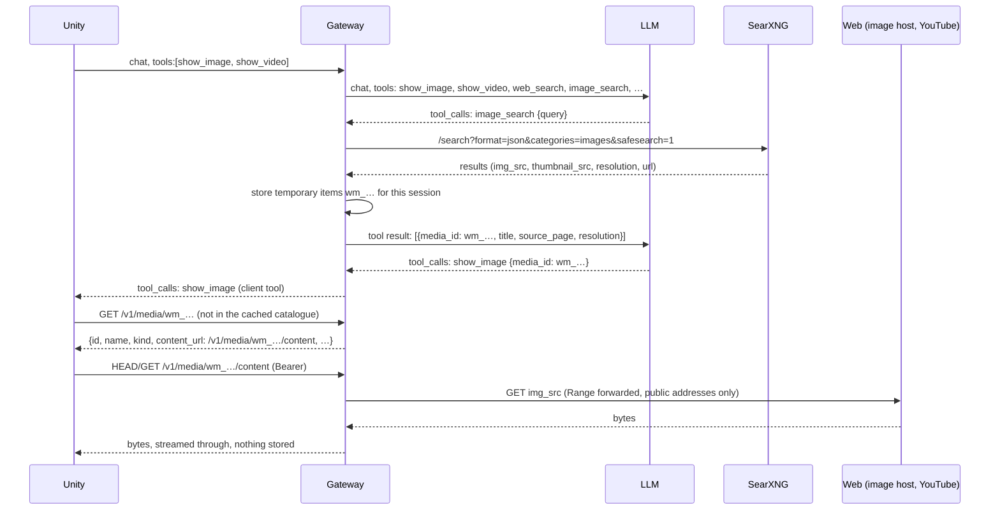

# Web search, page reading, and found images and videos

The gateway can let a model search the web, read pages, and show images and videos it finds.
Search runs on a self-hosted [SearXNG](https://docs.searxng.org/) instance. The gateway runs the
search itself as **built-in tools**, in the same plain-chat tool loop as MCP tools
([mcp.md](mcp.md)). The client never sees these tools. It only receives `media_id`s it can show,
and the gateway streams those media through to it.



## Setting it up

1. Start SearXNG with the compose profile `search`. It runs on the internal compose network only,
   with no published port. Its settings (`searxng/settings.yml`) add `json` to
   `search.formats`, which the gateway needs:
   ```bash
   docker compose --profile search up -d --build
   ```
2. In `.env`, set `SEARXNG_URL=http://searxng:8080`. Optionally set `SEARCH_SAFESEARCH` (0 off,
   **1 moderate, the default**, 2 strict) and `SEARXNG_SECRET` (any long random string). Restart
   the app.
3. In **Model Routes**, edit a route and tick the built-in tools it should offer. All of them are
   **off by default**. A tool this deployment cannot run is marked *Not configured* and is not
   offered, even when ticked.

Without `SEARXNG_URL` the tools do not exist. Any SearXNG instance with JSON output enabled works,
for example an existing one on your LAN.

| Variable | Default | Meaning |
|---|---|---|
| `SEARXNG_URL` | unset | SearXNG base URL. Turns the built-in tools on. |
| `SEARCH_SAFESEARCH` | `1` | Sent on every query. A deployment setting: the model can never choose or override it. |
| `YTDLP_PATH` | `yt-dlp` | yt-dlp executable for video playback. The Docker image bundles it, so set this only for local `pnpm dev`. |
| `SEARXNG_SECRET` | empty | Compose `search` profile only: signs SearXNG's cookies. |

## The tools

They are offered on **plain-chat routes only**: `/v1/chat/completions` and `/v1/responses`
without an agent. Agent chatflows do not offer them yet. Each call counts as one round of the
loop (at most four), and is recorded in the transcript with a **Built-in** badge.

| Tool | Arguments | Returns |
|---|---|---|
| `web_search` | `query`, `max_results` (1–10, default 5) | `{results:[{title,url,snippet}]}` from the SearXNG `general` category, without duplicates |
| `read_web_page` | `url`, `offset` (default 0) | `{url,title,offset,next_offset,total_chars,content,note?}` |
| `image_search` | `query`, `max_results` (1–10, default 5) | `{results:[{media_id,title,description,source_page,resolution?}]}` |
| `video_search` | `query`, `max_results` (1–10, default 5) | `{results:[{media_id,title,description,source_page,duration_seconds?}]}`, **YouTube videos only** |

Failures such as an unreachable backend, a blocked address or a page error come back to the model
as `Error: …` tool results, and the loop continues.

### read_web_page

- A plain HTTP fetch, then [Mozilla Readability](https://github.com/mozilla/readability) on a
  `jsdom` document. Scripts never run and no subresources load. There is **no headless browser**:
  pages that render only with JavaScript return little or no text, and the result carries a
  `note` that says so.
- Downloads at most **2 MB**, within **10 s**. Each call returns at most **8000 characters**, cut
  at whitespace. When `next_offset` is not null, call again with `offset=next_offset` to continue.
  The page is fetched again on every call.
- HTML and text types are read. Anything else (PDF, images) is an error.

### Public addresses only

Every outbound fetch the gateway makes itself (pages, images, video streams) goes through one
guard. yt-dlp is only ever given a `https://www.youtube.com/watch?v=<id>` URL that the gateway
builds from a video id, so it contacts nothing else.

- `http` and `https` only, with no credentials in the URL.
- Refused: loopback, private (10/8, 172.16/12, 192.168/16, fc00::/7), link-local (169.254/16,
  fe80::/10, which includes cloud metadata), CGNAT (100.64/10), multicast and reserved ranges,
  IPv4-mapped forms of all of these, and `localhost` names.
- Checked for literal IPs and for **every address DNS returns, at connect time**, so DNS
  rebinding cannot slip through. Redirects are followed by the gateway and **re-checked on every
  hop** (at most 5).

## Temporary media items

`image_search` and `video_search` store each result as a **temporary item** in
`web_media_items`, with an id of `wm_` plus 16 hex characters. An item holds the session, the API
key, the kind, the title, the source page, the media URL (the image file, or the video page), the
thumbnail, the resolution or length, and once played, the resolved stream URL. **No bytes are
stored.**

- **Who can see it**: only the API key whose session found it, and only while that session is
  active. Anyone else gets `404 media_not_found`, exactly like an unknown id.
- **Lifetime**: deleted when the session ends (`POST /v1/sessions/{id}/end`, an admin's End, or an
  agent change) or expires (idle sweep), and removed with the session on purge or delete.
- **Activity**: looking up or streaming an item refreshes the session's idle timer, at most once a
  minute, so a long video does not let the session expire mid-playback.

### Client API

- `GET /v1/media/{id}` returns one item in the same shape as `/v1/media` entries:
  `{id,name,description,kind,tags,content_url,mime_type}`. It works for catalogue items and for
  temporary items. Temporary items carry `tags: ["web"]`, a description such as
  `Web image from commons.wikimedia.org, 1024×768.`, and a `content_url` that always points at the
  gateway.
- `GET|HEAD /v1/media/{wm_…}/content` **streams the bytes through**. `Range` and `If-Range` are
  forwarded, and `Content-Range`, `Content-Length`, `Accept-Ranges`, `ETag` and `Last-Modified`
  come back, so a video player can seek. Responses are `Cache-Control: private, no-store`. A source
  that fails answers `502 media_unavailable`, with a message the client can pass back to the model.

Clients that cache the catalogue (Unity loads it once per session) should call
`GET /v1/media/{id}` once when the model names an id they do not know, and show the item if it is
found.

### Images

The proxy tries the full-size `img_src` first, sending the source page as `Referer`. It falls back
to the search engine's thumbnail when the source refuses, is not PNG, JPEG, GIF or WebP, or is
larger than 20 MB. The URL that worked is cached on the item, so later (ranged) requests get the
same bytes.

### Videos (YouTube via yt-dlp)

Video search and playback support **YouTube only**. `video_search` keeps the SearXNG `videos`
results that are YouTube videos: a watch, short, embed or `youtu.be` link, either as the result
URL or as its embed URL (other engines often find YouTube videos too). It stores each one as the
canonical watch URL. Results from other sites are skipped, so the model only sees videos that can
play. An item whose URL is not YouTube answers `Only YouTube videos can be played.`

- The gateway image bundles **yt-dlp at a pinned version** (`YT_DLP_VERSION` in the `Dockerfile`,
  with `yt-dlp-ejs` for YouTube). It is updated only with gateway releases, and uses the image's
  Node as its JavaScript runtime (`--js-runtimes node`).
- A video is resolved **lazily, on the first request of its `content_url`**. The resolved URL and
  headers are cached on the item for the rest of the session. Parallel first requests run yt-dlp
  once.
- Format: the **best single MP4 that already has picture and sound, at most 720p**, served over
  plain http(s) (`b[ext=mp4][vcodec!=?none][acodec!=?none][protocol~='^https?$'][height<=?720]`).
  Unknown codecs pass the filter. There is no ffmpeg and no merging. On YouTube this is usually
  the 360p stream, since YouTube no longer offers 720p as a single file. There is **no length
  limit**.
- YouTube links become valid only after the length of the ad the site would have played (yt-dlp
  reports `available_at`, typically 5 to 6 s). The proxy waits for that before the first GET,
  for at most 30 s, while a `HEAD` probe answers as soon as the video resolved (about 2 to 3 s).
- yt-dlp has 60 s to resolve. A failure is cached, so the item keeps answering
  `502 media_unavailable` with yt-dlp's reason (for example
  `This video has no MP4 with picture and sound at 720p or below.` or an age or sign-in
  restriction) instead of retrying. Unity shows that error and reports it back to the model.
- Resolved links expire after a while (hours, on YouTube). An expired link simply fails playback
  with `502`. This is accepted: search again for a fresh item.
- Without a working yt-dlp, `video_search` is *Not configured* and is not offered.

## Admin API

| Endpoint | Purpose |
|---|---|
| `GET /api/admin/builtin-tools` | `{data:[{name,label,summary,available,unavailable_reason?}]}` |
| Route `builtin_tools` | `POST/PUT /routes` take the selected tool names; unknown names are `400`. Off by default. |

## Local development

- `pnpm exec tsx tests/support/run-mock-upstream.ts` serves the mock provider. Its upstream model
  `gateway-tool` calls the tool named in the user message JSON, for example
  `{"tool":"web_search","args":{"query":"red panda"}}`, then answers `Result: <tool result>`.
- Point `SEARXNG_URL` at any SearXNG with JSON enabled, or run the image locally:
  `docker run -p 127.0.0.1:8080:8080 -v ./searxng/settings.yml:/etc/searxng/settings.yml:ro searxng/searxng:<tag>`.
- For videos outside Docker, install yt-dlp and set `YTDLP_PATH`.
- Tests use `tests/support/mock-searxng.ts`, `tests/support/mock-web-media.ts` and a fake yt-dlp
  runner (`setYtDlpForTests`). Only `127.0.0.1` is allowed through the address guard, via
  `setTestAllowedAddresses`; production never calls either.

## Troubleshooting

| Symptom | Likely cause |
|---|---|
| Tools show *Not configured* | `SEARXNG_URL` is not set (or, for video search, yt-dlp is missing) |
| `Error: The search backend refused JSON output` | Add `json` to `search.formats` in SearXNG's `settings.yml` |
| `Error: The search backend is unreachable` | Wrong `SEARXNG_URL`, or SearXNG is not on the same network |
| Few or no results | Upstream engines are rate-limiting SearXNG; check its logs (`docker compose logs searxng`) |
| `read_web_page` returns a JavaScript note | The page renders client-side; there is no headless browser |
| Image shows as an error | The source and the thumbnail both failed; the 502 message says why |
| Video shows as an error | yt-dlp could not find a single MP4 with sound at 720p or below, the video is restricted (age, region, members), or its link expired |
| `video_search` returns fewer results than asked | Only YouTube results are kept; ask for more or rephrase |
| `404 media_not_found` for a `wm_…` id | Another API key, or the session ended or expired; temporary items live only as long as their session |
